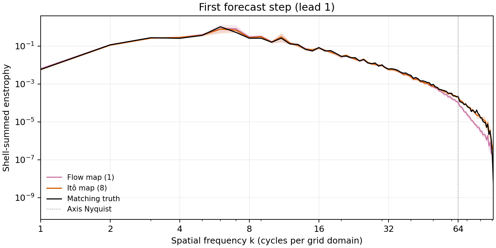
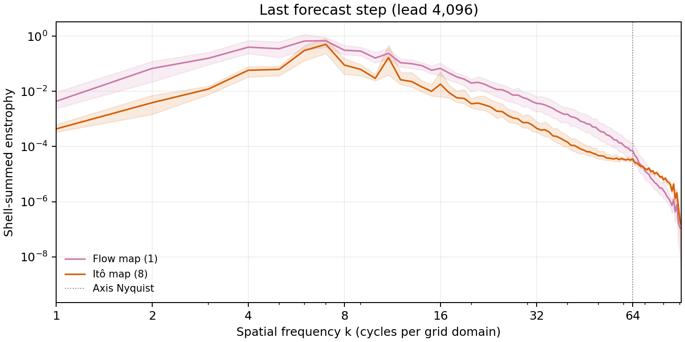
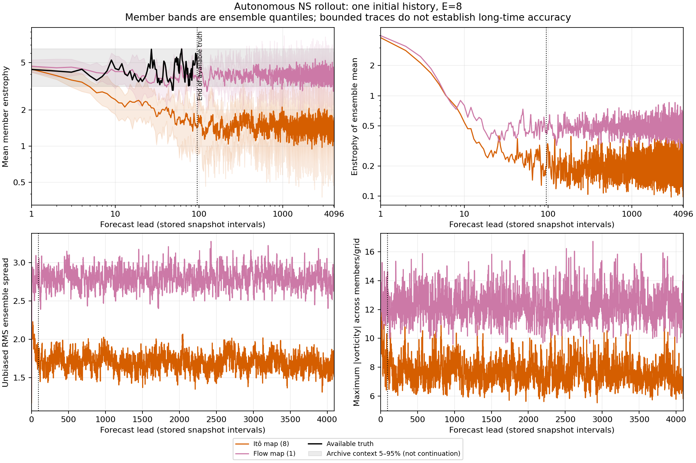
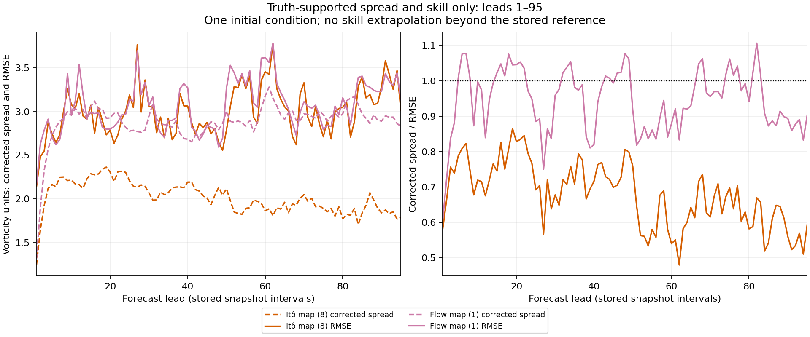

# Long autonomous Navier–Stokes diagnostics

**Partial model comparison:** this development report omits one or more of the four prespecified model families. Completed curves do not constitute the complete study.

One held-out initial condition (trajectory 180, origin 5), E=8, requested horizon 4096 stored snapshot intervals. Truth supports only the first 95 forecast leads.

The plots use denormalized archive vorticity. Enstrophy is half the spatial mean of squared vorticity; member-mean enstrophy and enstrophy of the ensemble mean are distinct. Member bands show 5–95% ensemble quantiles, not confidence intervals. Both enstrophy panels use log-log axes from lead 1, without positive floors or modified diagnostics; nonpositive values cannot be shown on logarithmic axes. The spread/skill ratio uses unbiased RMS spread with the sqrt((E+1)/E) finite-ensemble correction.

| Model (steps/frame) | Status | Last recorded lead | Last all-finite lead | First nonfinite lead | Last finite enstrophy | Last finite RMS spread | Generation seconds |
|---|---|---:|---:|---:|---:|---:|---:|
| Itô map (8) | complete | 4096 | 4096 | — | 1.4472 | 1.6348 | 1791.3 |
| Flow map (1) | complete | 4096 | 4096 | — | 4.0026 | 2.8317 | 203.36 |

The requested spatial spectra use log-log spatial-frequency axes and shell-summed enstrophy, not shell-averaged power. All square-grid modes enter the Parseval sum; DC is retained in the audit but omitted on the logarithmic axis. Shells above axis Nyquist contain corner modes only. The first-step truth is matched; no last-step truth is available.

The following scalar-over-lead plots are supplemental stability diagnostics, not spatial spectra.

Numerical boundedness over this one rollout does not establish stability for all initial conditions, correct invariant statistics, or accuracy beyond available truth. Generated trajectories are never clipped, reset to truth, or rescaled for these diagnostics. Curves end at the last recorded lead; absent curves after failure are not surviving-member averages. Recorded generation wall time is diagnostic and does not establish a controlled speedup, particularly when another process shared the device.

The gray enstrophy band pools 2000 held-out archive fields. It is contextual data, not a reference continuation or a stationary confidence interval.
