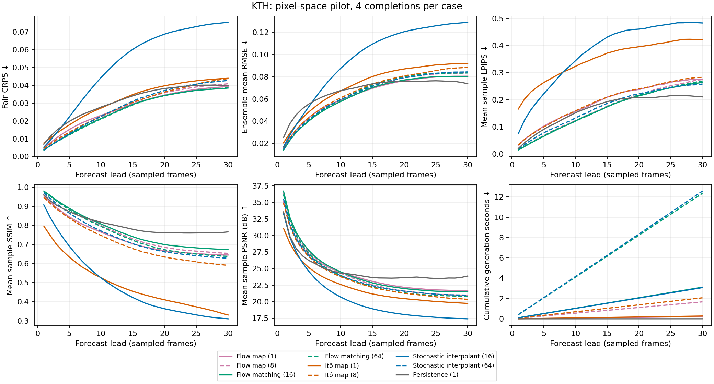
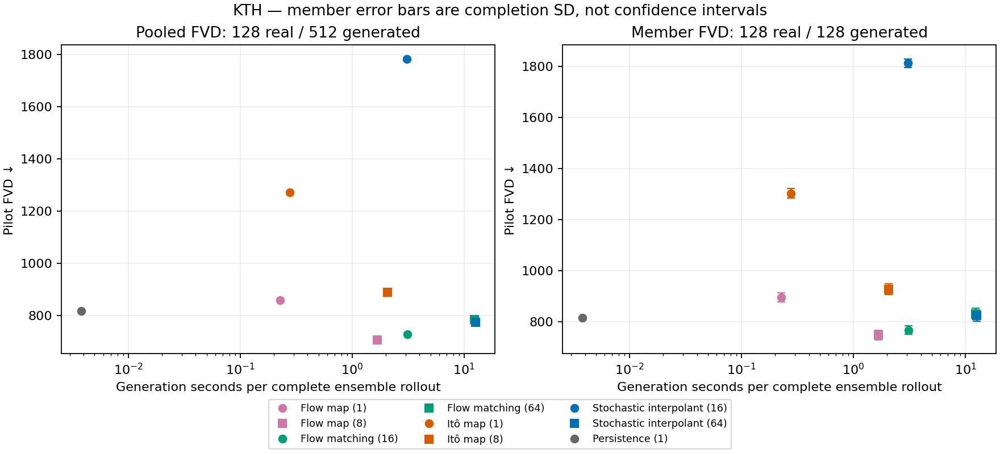
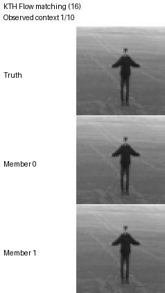

# KTH pixel-space pilot

Preliminary end-to-end results, not a reproduction of the paper's latent-space training or evaluation budget.

Matched protocol: 128 clips, 4 completions per clip; 10 observed + 30 forecast frames; stride 1; resolution 64; split `test`.

Quality columns average per-lead metrics, with each original source video equally weighted. Generation cost sums those per-lead means for the entire ensemble. Per-lead confidence intervals in the CSV use source-video bootstrap; they do not measure training-seed variation. FVD uses every selected clip and is not source-video reweighted.

| Model | Steps/frame | Mean CRPS ↓ | Mean LPIPS ↓ | Mean PSNR ↑ | Mean SSIM ↑ | Pooled FVD ↓ | Member FVD mean ± SD ↓ | Rollout seconds ↓ | Rollout NFE |
|---|---:|---:|---:|---:|---:|---:|---:|---:|---:|
| Flow map | 1 | 0.0276 | 0.1913 | 24.23 | 0.7333 | 857.2 | 895.1 ± 18.09 | 0.227 | 30 |
| Flow map | 8 | 0.02774 | 0.1676 | 23.98 | 0.7574 | 706.6 | 748 ± 19.03 | 1.673 | 240 |
| Flow matching | 16 | 0.02648 | 0.1634 | 24.3 | 0.7691 | 726.8 | 766.9 ± 17.16 | 3.115 | 480 |
| Flow matching | 64 | 0.02636 | 0.1649 | 23.72 | 0.749 | 783.1 | 831.5 ± 21.68 | 12.36 | 1920 |
| Itô map | 1 | 0.03191 | 0.3487 | 22.25 | 0.4858 | 1271 | 1302 ± 18.83 | 0.2765 | 30 |
| Itô map | 8 | 0.02857 | 0.1931 | 23.42 | 0.7064 | 888.2 | 926.5 ± 21.06 | 2.071 | 240 |
| Stochastic interpolant | 16 | 0.05265 | 0.3773 | 20.55 | 0.4797 | 1782 | 1813 ± 16.34 | 3.073 | 480 |
| Stochastic interpolant | 64 | 0.02853 | 0.1706 | 23.74 | 0.7346 | 773.5 | 823 ± 20.68 | 12.58 | 1920 |
| Persistence | 1 | 0.03112 | 0.165 | 24.77 | 0.8049 | 816.1 | 815.8 ± 0 | 0.003786 | 0 |

Pooled FVD compares 128 real clips with 512 generated clips. Each member FVD compares 128 real with 128 generated clips. Member SD describes completion randomness, not a confidence interval. Do not compare these values across datasets or against the paper's 256-real/25,600-generated table.

## Fixed qualitative case

Every animation uses the same first selected case and members 0 and 1. Display speed is 7 fps, not an assertion of physical frame rate. Observed context is included; future truth is never fed to forecasts. No examples are selected by score.

**Flow map: 1 steps/frame**

**Flow map: 8 steps/frame**

**Flow matching: 16 steps/frame**

**Flow matching: 64 steps/frame**

**Itô map: 1 steps/frame**

**Itô map: 8 steps/frame**

**Stochastic interpolant: 16 steps/frame**

**Stochastic interpolant: 64 steps/frame**

**Persistence: 1 steps/frame**

