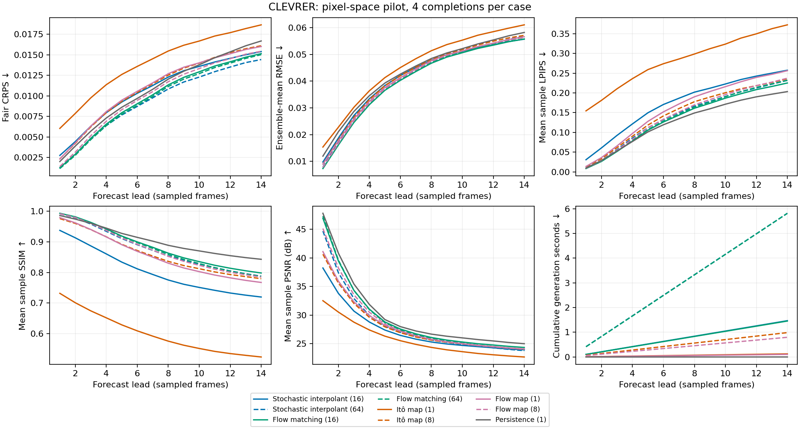
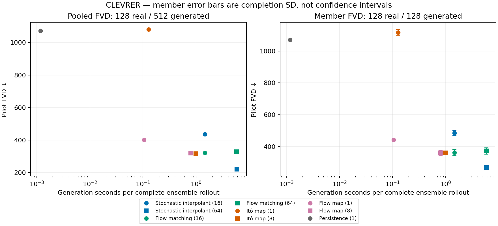
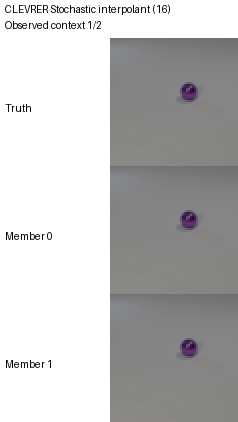
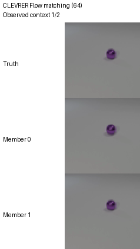
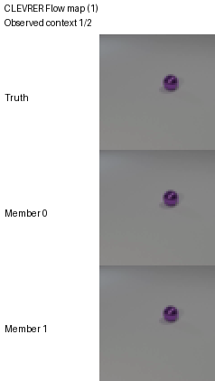
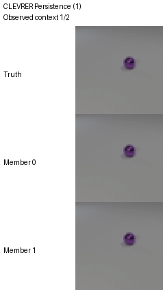

# CLEVRER pixel-space pilot

Preliminary end-to-end results, not a reproduction of the paper's latent-space training or evaluation budget.

Matched protocol: 128 clips, 4 completions per clip; 2 observed + 14 forecast frames; stride 5; resolution 64; split `test`.

Quality columns average per-lead metrics, with each original source video equally weighted. Generation cost sums those per-lead means for the entire ensemble. Per-lead confidence intervals in the CSV use source-video bootstrap; they do not measure training-seed variation. FVD uses every selected clip and is not source-video reweighted.

| Model | Steps/frame | Mean CRPS ↓ | Mean LPIPS ↓ | Mean PSNR ↑ | Mean SSIM ↑ | Pooled FVD ↓ | Member FVD mean ± SD ↓ | Rollout seconds ↓ | Rollout NFE |
|---|---:|---:|---:|---:|---:|---:|---:|---:|---:|
| Stochastic interpolant | 16 | 0.01074 | 0.1738 | 27.34 | 0.8032 | 436.1 | 485.3 ± 16.22 | 1.469 | 224 |
| Stochastic interpolant | 64 | 0.00937 | 0.1414 | 28.47 | 0.8756 | 222.3 | 268.9 ± 10.68 | 5.815 | 896 |
| Flow matching | 16 | 0.00977 | 0.1364 | 29.32 | 0.8834 | 323 | 361.8 ± 19.12 | 1.454 | 224 |
| Flow matching | 64 | 0.009601 | 0.1396 | 29.19 | 0.8788 | 330 | 372.1 ± 19.78 | 5.812 | 896 |
| Itô map | 1 | 0.01398 | 0.2827 | 25.69 | 0.6007 | 1080 | 1117 ± 18.93 | 0.1268 | 14 |
| Itô map | 8 | 0.01097 | 0.1484 | 28 | 0.86 | 317.3 | 360.5 ± 5.991 | 0.9861 | 112 |
| Flow map | 1 | 0.01101 | 0.1604 | 28.19 | 0.8549 | 402.2 | 442.7 ± 5.439 | 0.1046 | 14 |
| Flow map | 8 | 0.01012 | 0.1437 | 28.77 | 0.8747 | 320.4 | 359.9 ± 15.34 | 0.7969 | 112 |
| Persistence | 1 | 0.01069 | 0.1269 | 30.05 | 0.9039 | 1072 | 1072 ± 0 | 0.00117 | 0 |

Pooled FVD compares 128 real clips with 512 generated clips. Each member FVD compares 128 real with 128 generated clips. Member SD describes completion randomness, not a confidence interval. Do not compare these values across datasets or against the paper's 256-real/25,600-generated table.

## Fixed qualitative case

Every animation uses the same first selected case and members 0 and 1. Display speed is 7 fps, not an assertion of physical frame rate. Observed context is included; future truth is never fed to forecasts. No examples are selected by score.

**Stochastic interpolant: 16 steps/frame**

**Stochastic interpolant: 64 steps/frame**

**Flow matching: 16 steps/frame**

**Flow matching: 64 steps/frame**

**Itô map: 1 steps/frame**

**Itô map: 8 steps/frame**

**Flow map: 1 steps/frame**

**Flow map: 8 steps/frame**

**Persistence: 1 steps/frame**

