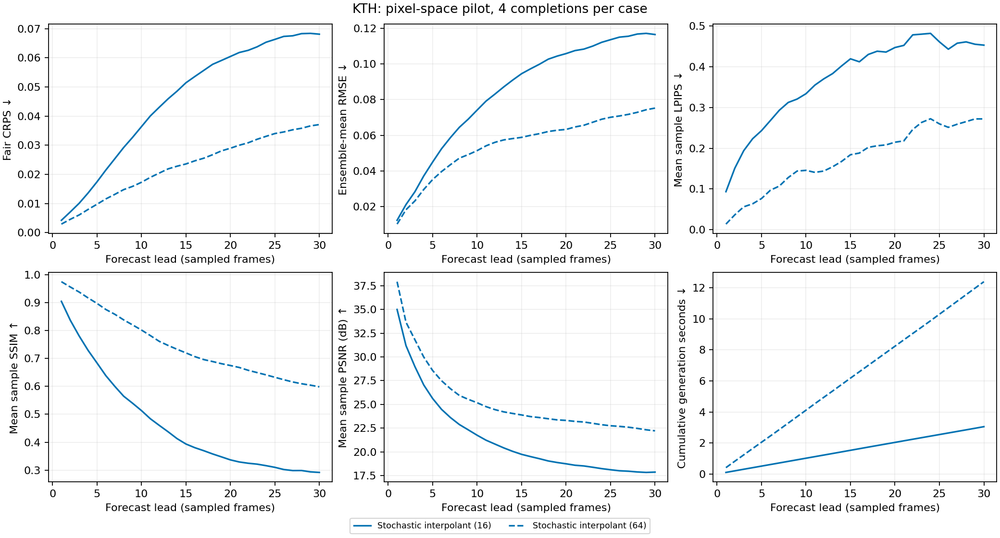
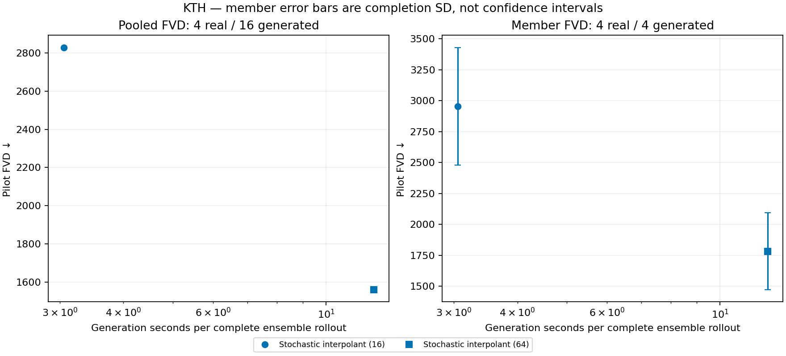
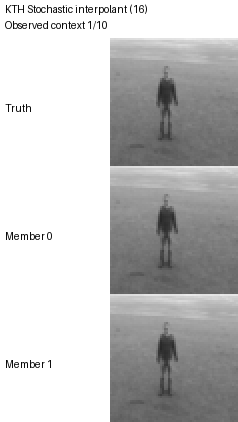

# KTH pixel-space pilot

Preliminary end-to-end results, not a reproduction of the paper's latent-space training or evaluation budget.

Matched protocol: 4 clips, 4 completions per clip; 10 observed + 30 forecast frames; stride 1; resolution 64; split `validation`.

Quality columns average per-lead metrics, with each original source video equally weighted. Generation cost sums those per-lead means for the entire ensemble. Per-lead confidence intervals in the CSV use source-video bootstrap; they do not measure training-seed variation. FVD uses every selected clip and is not source-video reweighted.

| Model | Steps/frame | Mean CRPS ↓ | Mean LPIPS ↓ | Mean PSNR ↑ | Mean SSIM ↑ | Pooled FVD ↓ | Member FVD mean ± SD ↓ | Rollout seconds ↓ | Rollout NFE |
|---|---:|---:|---:|---:|---:|---:|---:|---:|---:|
| Stochastic interpolant | 16 | 0.04577 | 0.3716 | 21.4 | 0.4619 | 2829 | 2955 ± 475.5 | 3.053 | 480 |
| Stochastic interpolant | 64 | 0.02283 | 0.1752 | 25.29 | 0.7458 | 1561 | 1783 ± 310.4 | 12.4 | 1920 |

Pooled FVD compares 4 real clips with 16 generated clips. Each member FVD compares 4 real with 4 generated clips. Member SD describes completion randomness, not a confidence interval. Do not compare these values across datasets or against the paper's 256-real/25,600-generated table.

## Fixed qualitative case

Every animation uses the same first selected case and members 0 and 1. Display speed is 7 fps, not an assertion of physical frame rate. Observed context is included; future truth is never fed to forecasts. No examples are selected by score.

**Stochastic interpolant: 16 steps/frame**

**Stochastic interpolant: 64 steps/frame**

